# Awesome-Environmental-Sustainability-Waste-Reduction


  





  
  
  
  
  



# 🌱 Top Environmental Sustainability & Waste Reduction

**Curated List of SaaS/Commercial Platforms & Open-Source GitHub Projects**  
*Focused on Carbon Accounting (Scope 1–3), Life Cycle Assessment (LCA), Circular Waste Reduction, Grid Carbon Intensity APIs & Green Software Engineering*  
**Last updated: November 2026**

This repository tracks notable **SaaS/Commercial platforms** and **open-source projects** for **Environmental Sustainability & Waste Reduction**. These tools power Scope 1, 2, and 3 greenhouse gas (GHG) accounting, ISO-compliant Life Cycle Assessment (LCA), circular waste tracking and zero-waste apps (`ZeroTrash`), real-time electricity grid carbon-intensity APIs (`Electricity Maps`), and compute/cloud emissions tracking (`CodeCarbon`, `Cloud Carbon Footprint`) for sustainability engineers, ESG data teams, and green software developers.

**Examples** include Sphera (Blackstone), Watershed, Persefoni, Rubicon, Sweep, Greenly, Plan A, CarbonCloud, Emitwise, and Sinai Technologies (the category leaders).

**🚀 Open-source emphasis**: This section is heavily expanded with every major active project for zero-waste and circular economy apps (`zerotrashapp/zerotrash`, `Open Food Facts`, `Repair Café / Fixometer`), open Life Cycle Assessment (`Brightway`, `OpenLCA`), real-time grid carbon intensity (`Electricity Maps`, `WattTime / Carbon Aware SDK`), and software/cloud emissions tracking (`CodeCarbon`, `Cloud Carbon Footprint`, `Kepler`, `Scaphandre`) — ideal for climate-tech builders, researchers, and organizations pursuing transparent, auditable sustainability metrics.

🤝 Contributions welcome! Open a PR to add/update entries. Keep descriptions factual and link to official sites.

## 📑 Table of Contents
- [📊 Sector Overview & Market Dynamics](#-sector-overview--market-dynamics)
- [☁️ SaaS/Hosted & Commercial Platforms](#️-saashosted--commercial-platforms)
- [💻 Open-Source GitHub Projects](#-open-source-github-projects)
- [🛠️ How to Contribute](#️-how-to-contribute)
- [⚠️ Disclaimer](#️-disclaimer)
- [💖 Support & Thank You](#-support--thank-you)

## 📊 Sector Overview & Market Dynamics

The global Carbon Accounting, ESG Software & Smart Waste Management market is valued at approximately **$24B–$30B+ in 2026** (with enterprise carbon management & sustainability SaaS accounting for **$7.5B–$9.8B**), expanding at a ~18%–24% CAGR propelled by EU CSRD, ISSB, and global supply-chain Scope 3 disclosure mandates. The enterprise reporting software layer is **moderately consolidated** around scaled leaders (Sphera, Watershed, Persefoni, Sweep, Greenly), while the scientific Life Cycle Assessment (LCA), grid carbon telemetry, and green-compute layers are **heavily anchored by open-source standards** (`OpenLCA`, `Brightway`, `Electricity Maps`, `CodeCarbon`, `Kepler`).

## ☁️ SaaS/Hosted & Commercial Platforms

*Sorted descending by company valuation / annual revenue scale.*

| Platform | Description | Company Scale (Valuation / Revenue) | Starting Paid Tier | Free Tier / Trial Limit |
| :--- | :--- | :--- | :--- | :--- |
| **[Sphera (Blackstone)](https://sphera.com)** | Enterprise ESG performance, Product Sustainability Life Cycle Assessment (LCA / GaBi), and EHS risk management software suite. | **~$1.4B+ Acquisition Valuation** (Acquired by Blackstone; ~$300M+ annual revenue) | **~$15,000 – $30,000+ / year** indicative enterprise LCA & ESG module licensing | **Guided Enterprise Demo / Academic Edition** (No public self-serve SaaS free tier; limited academic LCA evaluation licenses via university request) |
| **[Watershed](https://watershed.com)** | Enterprise climate platform helping global corporations measure Scope 1–3 emissions, run CSRD/SEC audit-grade reporting, and fund carbon removal. | **$1.8B Valuation** (~$100M+ est. ARR; $170M+ VC funding) | **~$25,000 – $50,000+ / year** indicative enterprise subscription (scales by company revenue/complexity) | **Guided Enterprise Demo / Carbon Calculator Preview** (No self-serve free SaaS workspace; custom carbon footprint assessment on request) |
| **[Persefoni](https://persefoni.com)** | Climate Management & Accounting Platform (CMAP) built on PCAF and GHG Protocol standards for corporate and financial-institution carbon accounting. | **~$500M–$700M Est. Valuation** (~$40M–$60M est. ARR; $179M+ VC funding) | **~$10,000 – $25,000+ / year** for Persefoni Enterprise/Pro corporate tiers | **Forever Free Persefoni Pro Starter Tier** (Free Scope 1, 2, and basic Scope 3 GHG inventory calculator for small businesses and startups) |
| **[Rubicon](https://rubicon.com)** | Cloud-based smart waste, recycling, and fleet circularity platform optimizing waste diversion, route telemetry, and landfill reduction for enterprises and cities. | **~$300M–$500M Enterprise Scale** (~$650M+ gross waste-hauling/software revenue) | **Usage / Tonnage-Based SaaS & Hauling Contracts** (~$250+/mo indicative SaaS smart-fleet/diversion portal) | **Custom Waste & Diversion Audit Demo** (No public self-serve free tier; commercial waste-stream assessment via sales) |
| **[Sweep](https://sweep.net)** | Collaborative carbon and ESG data management platform enabling enterprises to map supply-chain Scope 3 emissions and CSRD compliance targets. | **~$300M–$450M Est. Valuation** (~$20M–$35M est. ARR; $100M+ VC funding) | **~$15,000 – $30,000+ / year** indicative mid-market/enterprise license | **Guided Platform Demo / Pilot** (No public self-serve free tier; interactive climate-journey sandbox available upon request) |
| **[Greenly](https://greenly.earth)** | Automated carbon accounting and climate-action platform integrating directly with ERP, accounting, and cloud billing APIs for SMBs and mid-market firms. | **~$250M–$400M Est. Valuation** (~$25M–$40M est. ARR; $75M+ Series B funding) | **~$3,000 – $6,000 / year** (~$250–$500/mo billed annually) for SMB Essentials carbon assessment | **Free Carbon Footprint Estimate / Demo** (Interactive baseline emissions estimator and guided software walkthrough; no perpetual full SaaS free tier) |
| **[Plan A](https://plana.earth)** | Certified corporate carbon accounting, decarbonization planning, and EU CSRD/ESRS sustainability reporting SaaS platform. | **~$100M–$150M Est. Valuation** (~$10M–$20M est. ARR; $37M+ VC funding) | **~$8,000 – $15,000+ / year** indicative starting corporate carbon management tier | **Guided Demo & Free Sustainability Academy** (No public self-serve free SaaS workspace; free educational ESG tools & custom demo) |
| **[CarbonCloud](https://carboncloud.com)** | Automated product-level carbon footprint and food-supply-chain Life Cycle Assessment (LCA) platform providing climate-label intelligence. | **~$40M–$70M Est. Valuation** (~$5M–$10M est. ARR; $15M+ VC funding) | **~$500 – $1,500+ / month** indicative SaaS tier for food/CPG SKU footprinting | **Free ClimateHub Public Product Database** (Free searchable database of thousands of food product carbon footprints; paid SaaS for custom SKU modeling) |
| **[Emitwise](https://emitwise.com)** | AI-powered supply-chain carbon accounting platform automating supplier-specific Scope 3 emissions collection and procurement decarbonization. | **~$30M–$50M Est. Valuation** (~$5M–$10M est. ARR; $13M+ VC funding) | **~$12,000 – $25,000+ / year** indicative enterprise supply-chain tier | **Guided Supplier-Portal Demo** (Free supplier onboarding portal for invited vendors; enterprise buyer workspace via demo) |
| **[Sinai Technologies](https://sinaitechnologies.com)** | Enterprise decarbonization intelligence platform combining GHG inventorying with marginal abatement cost curves (MACC) and internal carbon pricing. | **~$50M–$80M Est. Valuation** (~$5M–$10M est. ARR; $36M+ VC funding) | **~$15,000 – $30,000+ / year** indicative enterprise decarbonization license | **Guided Enterprise Demo** (No public self-serve free tier; custom decarbonization modeling demo via enterprise sales) |

## 💻 Open-Source GitHub Projects

| Project | License / Hosting Cost | Free Tier / Self-Hosted Limit | Description |
| :--- | :--- | :--- | :--- |
| **[ZeroTrash (`zerotrashapp/zerotrash`)](https://github.com)** | **Open-Source** ($0 mobile/web waste-reduction & community cleanup app) | **100% Free forever** (Unlimited community litter mapping, waste-reduction tracking, and local zero-waste challenges) | Open-source sustainability application empowering individuals and communities to track waste reduction, log cleanups, and promote zero-waste habits. |
